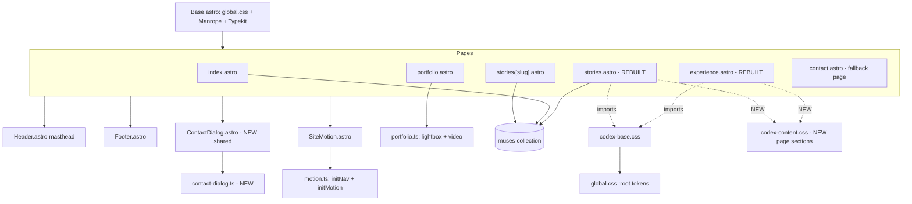
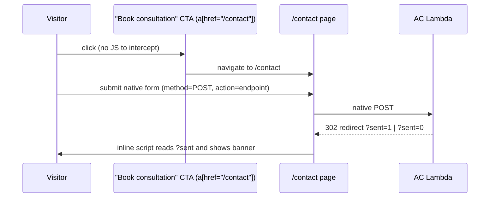

# Design Document: Codex Experience, Stories & Sitewide Contact Dialog

## Overview

This feature finishes unifying The Glam Muse Series site to the Codex design
system. Home (`index.astro`) and Portfolio (`portfolio.astro`) already run the
Codex look — the shared primitives, tokens and motion live in
`src/styles/codex-base.css`, `src/styles/codex-portfolio.css`,
`src/scripts/motion.ts`, `src/scripts/portfolio.ts`, and `SiteMotion.astro`.
Two pages still use their original bespoke layouts (`.ex-*` and `.ms-*` classes
styled by `src/styles/global.css`): **The Experience** and **Muse Stories**.

Part A re-expresses those two pages in the Codex design system. There is **no
Codex original** for either page (Codex only built home + portfolio), so this
is *new layout design inside* the Codex system — composing the ported Codex
primitives (hero masthead treatment, `.display-title` at `font-weight:100`,
`.eyebrow`, `.short-rule`, `.button`, `.image-frame`, section rhythm, GSAP
`data-reveal`/`data-hero-item` motion) into section structures that carry the
existing content forward. All page imagery routes through `Pic.astro`, and the
`muses` content collection + Sveltia CMS and the working featured rotator are
preserved.

Part B converts Contact from a standalone page into a **sitewide popup** built
on the native `<dialog>` element and the Codex `.dialog` / `.consultation-dialog`
styles that already exist (unused) in `codex-base.css`. The real ActiveCampaign
Lambda backend (`PUBLIC_AC_FORM_ENDPOINT`) is preserved verbatim — the dialog
submits to the same endpoint the same way. The `/contact` page is **kept** as a
no-JS fallback and direct-link target; the dialog is progressive enhancement
layered over it. The new dialog slots into the existing single-dialog invariant
and `body.dialog-open` pattern already established by `portfolio.ts`.

## Architecture

### Current state (grounded in the real files)

| Concern | Home / Portfolio (Codex, done) | Experience / Stories (bespoke, to migrate) |
| --- | --- | --- |
| Styles | `codex-base.css` (+ `codex-portfolio.css`) | `global.css` `.ex-*` / `.ms-*` blocks |
| Masthead | `Header.astro` `.site-header` / `.brand` / `.primary-nav` | same `Header.astro`, but styled by `global.css` `.site-header`/`.nav-cta` leftovers |
| Type scale | `.display-title`, `.eyebrow`, `.short-rule` | `.display` (weight 100) + bespoke `.ex-*`/`.ms-*` headings |
| Motion | `SiteMotion.astro` → `initNav()` + `initMotion()` | `SiteMotion.astro` already included; markup uses `data-reveal`/`data-hero-item` already in places |
| Images | `Pic.astro` (astro:assets `<Picture>`) | raw `` |
| Tokens | `--content-width:1120px`, `--header-h:140px`, 112px gutter | same `:root`, but local widths use `.wrap` (also 112px gutter) |

Both target pages already import `codex-base.css` and already render
`SiteMotion.astro`, so the motion/nav layer is wired — the migration is a
markup + class rename to Codex primitives, plus routing `` through `Pic`.

### Target architecture



**New files**

- `src/components/ContactDialog.astro` — the shared contact `<dialog>` + AC form.
- `src/scripts/contact-dialog.ts` — opens/closes the dialog, AC fetch submit,
  `?sent=` fallback banner, single-dialog + `body.dialog-open` integration.
- `src/styles/codex-content.css` — the new Experience + Stories section styles
  (`.ex2-*` / `.ms2-*` or similar), authored against the Codex tokens. Keeps
  `global.css` untouched so the story-detail page and any other legacy surfaces
  keep working during migration.

**Changed files**

- `src/pages/experience.astro` — rebuilt markup (Codex primitives + `Pic`).
- `src/pages/stories.astro` — rebuilt markup (Codex primitives + `Pic`),
  featured rotator preserved.
- `src/components/Header.astro` — the nav `Contact` link gains a dialog hook.
- `src/components/Footer.astro` — the footer `Contact` link gains a dialog hook.
- `src/pages/index.astro`, `portfolio.astro`, `stories/[slug].astro` — the
  "Book your consultation" CTAs gain the dialog hook (page markup otherwise
  unchanged; `[slug].astro` stays on `global.css` for now).

**Shared conventions reused as-is**

- Single-dialog invariant: before `showModal()`, close any `dialog[open]`;
  set `body.dialog-open`; clear it on `close` only when no dialog remains open;
  restore focus to the invoking trigger. This mirrors `initLightbox` /
  `initExperienceVideo` in `portfolio.ts` exactly.
- Progressive enhancement: nothing is hidden by JS. If a script fails to load,
  CTAs remain real `<a href="/contact">` links and `/contact` still works.

## Sequence Diagrams

### Contact dialog open + AC submit (JS available)

```mermaid
sequenceDiagram
    participant U as Visitor
    participant CTA as "Book consultation" CTA (a[data-open-contact])
    participant D as "#contact-dialog <dialog>"
    participant S as contact-dialog.ts
    participant AC as AC Lambda (PUBLIC_AC_FORM_ENDPOINT)

    U->>CTA: click
    CTA->>S: click handler (preventDefault)
    S->>S: close any other open dialog
    S->>D: showModal(); body.dialog-open = true
    U->>D: fill + submit form
    D->>S: submit (preventDefault after reportValidity)
    S->>AC: fetch POST JSON
    AC-->>S: { ok: true | false }
    alt ok
      S->>D: show success status; form.reset()
    else error / network
      S->>D: show error status
    end
    U->>D: Escape / close button
    D->>S: close event -> body.dialog-open = false; focus returns to CTA
```

### Contact fallback (JS disabled or script failed)



## Components and Interfaces

### Component 1: `ContactDialog.astro` (NEW, shared)

**Purpose**: A single reusable native `<dialog>` containing the ActiveCampaign
consultation form, included once per page near the end of `<body>` (after
`Footer`, alongside `SiteMotion`). Opened by any `[data-open-contact]` trigger.

**Markup contract** (styled by the existing `.dialog` / `.consultation-dialog`
rules in `codex-base.css`, which are currently defined but unused):

```html
<dialog class="dialog consultation-dialog" id="contact-dialog" aria-labelledby="contact-dialog-title">
  <form method="dialog">
    <button class="dialog-close" type="submit" aria-label="Close contact form"><span aria-hidden="true">×</span></button>
  </form>
  <div class="consultation-dialog__content">
    <p class="eyebrow">Contact</p>
    <h2 id="contact-dialog-title">Start the conversation.</h2>
    <p class="dialog-intro">…carried from contact.astro hero lede…</p>
    <!-- AC form: identical fields + endpoint to contact.astro -->
    <form class="ct-form consultation-form" method="POST" action={import.meta.env.PUBLIC_AC_FORM_ENDPOINT}>
      …first, last, email, phone, reason, more, feel, hear (same name=… as today)…
      <button class="button" type="submit">Start the conversation</button>
      <p class="form-note">No pressure. No obligation…</p>
      <p class="form-status" role="status" aria-live="polite"></p>
    </form>
  </div>
</dialog>
```

**Responsibilities**:
- Render the AC form once with the SAME field `name` attributes and the SAME
  `action={PUBLIC_AC_FORM_ENDPOINT}` as `contact.astro` (so the Lambda contract
  is unchanged).
- Expose a stable DOM contract for `contact-dialog.ts`: `#contact-dialog`,
  the inner `.consultation-form`, a `.form-status` region, and the close button
  via `<form method="dialog">`.
- Carry no JS itself; behavior is in `contact-dialog.ts`.

**Design decision — two nested forms**: the outer `<form method="dialog">`
provides native close (its submit button dismisses the dialog without posting),
and the inner `<form method="POST">` is the real AC form. This matches the Codex
dialog-close pattern already used in `portfolio.astro`'s gallery/experience
dialogs. `method="dialog"` requires the close button to be inside its own form.

### Component 2: `contact-dialog.ts` (NEW)

**Purpose**: Progressive-enhancement controller for the contact dialog. It is
the contact analogue of `initExperienceVideo` in `portfolio.ts`, plus the AC
fetch/`?sent=` logic currently inline in `contact.astro`.

**Interface**:

```ts
/** Wire every [data-open-contact] trigger to open #contact-dialog, enhance
 *  the AC form submit with fetch, and show the ?sent= fallback banner. Safe
 *  no-op when the dialog is absent (e.g. a page without the component). */
export function initContactDialog(): void;

/** Shape POSTed to the AC Lambda — one string per present form field. */
export interface ContactPayload { [field: string]: string; }

/** Serialize a form's present fields to a flat string map (FormData -> object). */
export function serializeForm(form: HTMLFormElement): ContactPayload;
```

**Responsibilities / behavior** (ported from `contact.astro`'s inline script):
- `[data-open-contact]` click → `preventDefault`, close any other open dialog,
  `showModal()`, set `body.dialog-open`, remember the trigger for focus return.
- On form `submit`: run native `reportValidity()` first (so built-in prompts
  show); if valid, `preventDefault`, disable the submit button, show a
  "Sending…" status, `fetch` JSON to the endpoint, then show success (and
  `form.reset()`) or error from `{ ok }`.
- On dialog `close`: clear `body.dialog-open` only if no other dialog is open;
  return focus to the trigger.
- `?sent=1` / `?sent=0` banner: read `window.location.search` once on load and,
  because the fallback redirect lands on `/contact` (the page), this logic lives
  on BOTH the `/contact` page (as today) and — harmlessly — can be skipped in
  the dialog controller since the dialog path never navigates away. (See
  "Error Handling / fallback coexistence".)

### Component 3: Experience page (`experience.astro`, REBUILT)

See "Per-Page Section Structure → Experience".

### Component 4: Stories page (`stories.astro`, REBUILT)

See "Per-Page Section Structure → Stories". The featured rotator script is
preserved; only its surrounding markup/classes change.

### Component 5: `Header.astro` / `Footer.astro` (CHANGED)

The nav `Contact` and footer `Contact` links keep `href="/contact"` (fallback)
and gain `data-open-contact`. No structural change otherwise.

## Per-Page Section Structure

Both pages keep the token system (`--content-width`, `--header-h`, 112px
gutter), use `.container` (Codex) rather than `.wrap`, place `<Header/>`
absolutely inside the first section's hero (matching `index.astro` /
`portfolio.astro`), route every image through `Pic`, and keep `SiteMotion`.

### Experience — Codex section map

Content carried over verbatim from today's `experience.astro`: hero title
"AN EXPERIENCE THAT FEELS LIKE YOU." + lede; the 3-step process
(Consultation / Session / Reveal) with its copy; the "inside the experience"
4-image grid; the closing CTA "LET THIS BE YOUR MOMENT."

| New section | Codex primitive mapping | Motion hooks | Content source |
| --- | --- | --- | --- |
| `experience-hero` | `.hero` treatment: absolute `Header`, `hero__image` via `Pic` + veil, `hero__content` with `.eyebrow` + `.display-title`/`hero__title` (weight 100) + lede + a `.text-link` "Step inside ↓" | `data-hero-image`, `data-hero-line` on title lines, `data-hero-item` on lede/link | existing hero copy; `ex-hero.png` → `Pic` |
| `experience-process` | section rhythm like home `.experience`/portfolio `.portfolio-process`: `.eyebrow` + `.display-title` heading row + intro; 3 `data-reveal` cards each with `Pic` image, **small label numeral** (`.experience-step__number`-style: 13px uppercase `var(--champagne)`), `.short-rule`, `h3`, `p` | `data-reveal` per head row + per card | existing step data (`ex-process-1..3.webp`) |
| `experience-inside` | heading row (`.eyebrow` + `.display-title`) + a 4-up `.image-frame` grid, each `Pic` | `data-reveal` per figure | existing `ex-inside-1..4.webp` |
| `experience-cta` | Codex closing treatment (like `.closing`): `.eyebrow` + `.display-title` "LET THIS BE YOUR MOMENT." + `.short-rule` + a `.button data-open-contact href="/contact"` | `data-reveal` | existing CTA copy |

**Numerals**: process numerals stay SMALL label-style (13px uppercase,
`var(--champagne)`) exactly as the recent project change dictates — reuse the
`.experience-step__number` / `.portfolio-process__number` pattern, NOT the old
`global.css` `.ex-steps b` big-display numeral.

### Stories — Codex section map

Content carried over: hero "MUSE STORIES" + sub + lede; the FEATURED muse
rotator (JS-wired, cycles all 6 muses from the collection — behavior preserved);
the "MEET THE MUSES" grid from `getCollection('muses')`; the "LOOK AGAIN" band;
the "IN MOTION" video teaser; the closing CTA. The frontmatter data pipeline
(`getCollection('muses')`, `.sort(order)`, `featuredList`, `featuredIndex`,
`#ms-featured-data` JSON) is kept unchanged.

| New section | Codex primitive mapping | Motion hooks | Content source |
| --- | --- | --- | --- |
| `stories-hero` | `.hero` treatment: absolute `Header`, `hero__image` via `Pic` + veil, `.eyebrow` + `.display-title`/`hero__title` "Muse Stories" + sub `.eyebrow` + `.short-rule` + lede | `data-hero-image`, `data-hero-line`, `data-hero-item` | existing hero copy; `ms-hero.webp` → `Pic` |
| `stories-featured` | editorial two-column band like `.perspective`: `Pic` portrait (`.image-frame`) + copy column (`.eyebrow` label, `.display-title` name, tagline, para, `.button` link) + count control | **IDs preserved** (`#ms-featured-photo/label/name/tag/para/link/current`, `[data-featured-rotator/prev/next]`, `#ms-featured-data`) so the existing inline rotator script runs unchanged | `featured` + `featuredList` from collection |
| `stories-meet` | centered heading (`.eyebrow` + `.display-title` with flanking `.short-rule`) + `.stories__grid`-style 3-col grid of `.story-card`s, each `Pic` + title + rule, linking `/stories/{id}` | `data-reveal` per heading + per card | `getCollection('muses')` sorted by `order` |
| `stories-look` | dark tonal band (reuse `.experience` umber treatment or a closing-style band): `.display-title` "LOOK AGAIN." + `.eyebrow` sub + `Pic` + para | `data-reveal` | existing copy; `ms-look-again.webp` → `Pic` |
| `stories-motion` | video teaser row: a play-poster button + copy (`.eyebrow`, `.display-title` "IN MOTION.", para, `.text-link`). Reuse the privacy-preserving `<dialog>` pattern from portfolio if a real film is wired; otherwise keep the poster as a link placeholder as today | `data-reveal` | existing copy; `ms-motion.webp` → `Pic` |
| `stories-cta` | Codex closing treatment: `.eyebrow` + `.display-title` "YOU'VE SEEN THEIR STORIES." + italic line + `.short-rule` + `.button data-open-contact href="/contact"` | `data-reveal` | existing CTA copy |

**Featured rotator preservation**: the rebuilt `stories-featured` markup MUST
keep every id/attribute the existing inline `<script>` queries
(`#ms-featured-data`, `[data-featured-rotator]`, `#ms-featured-photo`,
`#ms-featured-label`, `#ms-featured-name`, `#ms-featured-tag`,
`#ms-featured-para`, `#ms-featured-link`, `#ms-featured-current`,
`[data-featured-prev]`, `[data-featured-next]`). Only the surrounding
CSS classes change to Codex equivalents. The script is pure DOM-id driven, so
it keeps working without edits. Note the current `#ms-featured-photo` is a raw
`` whose `src` the script swaps — if routed through `Pic`, the rotator
must still be able to set `.src` on the rendered `` (Pic passthrough for a
string src emits a plain ``; the collection `cardImage` values are strings,
so `Pic` renders a passthrough `` the script can mutate). This keeps the
rotator functional. (See Open Question OQ-3.)

## Contact Dialog — detailed design

### How it wires to the AC endpoint (unchanged backend)

- The dialog's inner form uses `action={import.meta.env.PUBLIC_AC_FORM_ENDPOINT}`
  and `method="POST"`, identical to `contact.astro`. Field `name`s are copied
  verbatim (`first`, `last`, `email`, `phone`, `reason`, `more`, `feel`, `hear`).
- `contact-dialog.ts` serializes `FormData` to a flat JSON object and
  `fetch`-POSTs it with `Content-Type: application/json`, reading `{ ok }` from
  the response — byte-for-byte the same enhancement already shipping in
  `contact.astro`. The Lambda is the single validation authority; the client
  does not add validation beyond native HTML constraints.

### Reconciling with existing dialogs

`portfolio.ts` already defines the single-dialog invariant for the gallery
lightbox (`#gallery-dialog`) and the experience video (`#experience-dialog`):
before opening, close any `dialog[open]`; toggle `body.dialog-open`; on close,
clear it only if no dialog remains open; restore focus to the trigger. The
contact dialog adopts the identical pattern in `contact-dialog.ts`. Because all
controllers check `document.querySelector('dialog[open]')`, they cooperate
without a shared singleton: opening Contact from the portfolio page closes a
lightbox if one is open, and vice-versa. The muse-story detail page
(`stories/[slug].astro`) has no dialogs today; its CTA simply opens the contact
dialog if `contact-dialog.ts` is present there, else navigates to `/contact`.

### Trigger inventory (every CTA that opens the dialog)

| Location | Current link | Change |
| --- | --- | --- |
| `index.astro` hero + closing "Book your consultation" | `a.button href="/contact"` | add `data-open-contact` |
| `portfolio.astro` closing "Book your consultation" | `a.button href="/contact"` | add `data-open-contact` |
| `experience.astro` CTA (rebuilt) | `a.button href="/contact"` | include `data-open-contact` |
| `stories.astro` featured + CTA (rebuilt) | `a href="/contact"` | include `data-open-contact` |
| `stories/[slug].astro` CTA | `a href="/contact"` | add `data-open-contact` |
| `Header.astro` nav `Contact` | `a.nav-contact href="/contact"` | add `data-open-contact` |
| `Footer.astro` `Contact` | `a href="/contact"` | add `data-open-contact` |

Every trigger keeps a real `href="/contact"` so no-JS users navigate to the
working fallback page.

## Data Models

### `muses` content collection (unchanged — `src/content.config.ts`)

The Astro Content-Layer glob collection whose `entry.id` is the filename stem
(the route slug). Both rebuilt pages read it exactly as today.

```ts
interface MuseData {
  number: string;        // "MUSE 001" — exact display string
  order: number;         // 1..6, drives grid + featured ordering
  name: string;          // "HEATHER"
  tagline: string;       // "Seeing Herself Differently."
  featured: boolean;     // true for the stories featured block (Heather)
  cardImage: string;     // stories grid thumb + home teaser + rotator src
  heroImage: string;     // [slug] hero
  gallery: string[];     // [slug] mosaic
  beforeImage: string; afterImage: string; motionImage: string;
  videoUrl?: string;     // CloudFront /media/*.mp4 (optional)
  heroPara: string; introPara: string; transformPara: string; // [slug] copy
  featuredPara?: string; // stories featured block literal sentence
}
```

**Usage by the rebuilt Stories page** (identical to current):
- `getCollection('muses')` → `.sort((a,b) => a.data.order - b.data.order)`.
- Grid cards map `{ src: cardImage, slug: id, n: number, name, tag: tagline }`.
- Featured = `.find(e => e.data.featured) ?? entries[0]`.
- `featuredList` = all entries → `{ slug, number, name, tagline, image: cardImage, para: featuredPara ?? default }`, JSON-embedded in `#ms-featured-data`.
- `featuredIndex` = index of the featured entry (for the `NN / NN` counter).

**Home page** continues to use the first 3 muses by `order`. The CMS schema
(`public/admin/config.yml`) and image pipeline are untouched.

### Contact form fields (unchanged — Lambda contract)

```ts
// name= attributes POSTed to PUBLIC_AC_FORM_ENDPOINT, same as contact.astro
interface ContactFormFields {
  first: string; last: string; email: string; phone: string; // required
  reason: string;                                             // required select
  more?: string;                                              // optional textarea
  feel: string;                                               // required textarea
  hear?: string;                                              // optional select
}
```

## Correctness Properties

### Property 1: AC backend contract is preserved

For every field `f` in
`ContactFormFields`, the dialog form renders an input with `name === f` and
the form `action` equals `PUBLIC_AC_FORM_ENDPOINT` with `method="POST"` —
identical to `contact.astro`. ∴ the Lambda sees the same payload shape from
the dialog as from the page.

### Property 2: Progressive enhancement never hides content

∀ triggers `t` with
`[data-open-contact]`: `t` also has `href="/contact"`. If `contact-dialog.ts`
fails to load or JS is off, activating `t` navigates to the working
`/contact` page. No CTA is a JS-only control.

### Property 3: Single open dialog

At any time `document.querySelectorAll('dialog[open]').length ≤ 1`
across contact + gallery + experience dialogs, because every `openX` closes
any existing `dialog[open]` before `showModal()`.

### Property 4: `body.dialog-open` reflects state

`body` has class `dialog-open` iff at
least one dialog is open; it is cleared on `close` only when no dialog remains
open. (Matches the `codex-base.css` `body.dialog-open { overflow: hidden }`.)

### Property 5: Focus returns to trigger

After a dialog `close`, if the invoking
trigger is still connected, focus returns to it (keyboard users are not
stranded).

### Property 6: Featured rotator invariance

The rebuilt Stories markup preserves every
DOM id/attribute the rotator script reads; given `featuredList.length > 1`,
pressing next/prev cycles the index as `(i ± 1 + n) % n` and updates
photo/label/name/tag/para/link/counter — unchanged from today.

### Property 7: Reduced motion safety

With `prefers-reduced-motion: reduce`, `initMotion`
registers zero tweens and the reveal safety-net still forces any
`[data-reveal]` to its visible resting state, so both rebuilt pages are fully
readable with no animation.

### Property 8: Images are responsive & non-upscaled

Every page image on the rebuilt
pages goes through `Pic`; imported `src/assets` rasters emit `<Picture>` with
capped widths, string `/images/*` sources emit passthrough ``.

### Property 9: Collection ordering total

`getCollection('muses').sort(by order)` yields
a deterministic sequence; grid order == featured-rotator order == `order`.

## Error Handling

### AC submit failure (dialog, JS path)
**Condition**: `fetch` rejects, or response `{ ok }` is false.
**Response**: show the error status ("Something went wrong sending your
message. Please try again."), re-enable the submit button, keep the dialog open
and the entered values intact (no `reset()` on error).
**Recovery**: the visitor can retry, or close the dialog and use `/contact`.

### Script absent / JS disabled
**Condition**: `contact-dialog.ts` never runs.
**Response**: CTAs behave as plain links to `/contact`; the page's native form
POSTs to the endpoint and the Lambda redirects back with `?sent=1|0`.
**Recovery**: `/contact`'s existing inline script reads `?sent=` and renders the
success/error banner (unchanged behavior).

### Fallback coexistence (`?sent=` + dialog)
The `?sent=` redirect only ever lands on the `/contact` **page** (the native
form's `action` is the endpoint; the Lambda redirects to the page). The dialog
path never navigates, so it never produces `?sent=`. Therefore the `?sent=`
banner logic stays on the `/contact` page only; the dialog controller does not
duplicate it. No conflict is possible.

### Empty muses collection
**Condition**: `getCollection('muses')` returns `[]` (should not happen — 6
seeds exist).
**Response**: Stories grid renders empty; `featured` falls back to
`entries[0]` which is `undefined`. **Design guard**: the rebuilt page keeps the
current `?? entries[0]` fallback and additionally guards the featured block
render when no entry exists, so the build does not throw.

### Missing dialog on a page
**Condition**: a page includes a `[data-open-contact]` trigger but not
`ContactDialog.astro`.
**Response**: `initContactDialog()` no-ops (null-guarded lookup); the trigger
falls back to navigation. **Design rule**: include `ContactDialog.astro` on
every page that has a trigger (all of them).

## Testing Strategy

### Unit / pure-function tests (Vitest, matches `muses.count.test.ts` presence)
- `serializeForm(form)` maps a populated `<form>`'s present fields to the
  expected flat object (empty optional fields serialize as `""`, matching the
  current inline behavior).
- Stories frontmatter helpers: given a mock `entries` array, assert the sort is
  by `order`, `featured` selection, `featuredList` shape, and `featuredIndex`.

### DOM / behavioral tests (jsdom or Playwright)
- Clicking `[data-open-contact]` opens `#contact-dialog`, sets `body.dialog-open`,
  and Escape/close returns focus to the trigger (Properties 3–5).
- Opening contact while the gallery dialog is open closes the gallery first
  (Property 3), on the portfolio page.
- Submit success path: mock `fetch` → `{ ok: true }` → success status +
  `form.reset()`; error path keeps values and shows the error status.
- Featured rotator: next/prev updates the live region ids and wraps at both
  ends (Property 6).

### Build / integration
- `astro build` succeeds with the rebuilt pages (no `global.css` `.ex-*`/`.ms-*`
  dependency left on those two pages); `Pic` emits `<picture>` for imported
  assets.
- Accessibility smoke: dialog has `aria-labelledby`, native focus trapping via
  `showModal()`, status region is `aria-live="polite"`; headings are a single
  `h1` per page then `h2`/`h3`.

### Visual regression (manual, reference the `_codex-ref` captures)
- Compare rebuilt Experience/Stories at desktop/tablet/mobile breakpoints
  (1441+, 1199, 960–769, 768, 380) against the Codex rhythm used by home +
  portfolio for consistency of gutter, header height, type scale, and reveals.

## Dependencies

- Existing: `astro`, `@fontsource-variable/manrope`, Adobe Typekit kit
  `mdr5myc` (ivypresto-display), `gsap` + `gsap/ScrollTrigger`,
  `astro:content`, `astro:assets`.
- Env: `PUBLIC_AC_FORM_ENDPOINT` (already present in `.env` / `.env.example`),
  `PUBLIC_ADOBE_FONTS_PROJECT`.
- No new runtime dependencies. New source files only (one component, one
  script, one stylesheet).

## Open Questions

- **OQ-1 — Keep or remove `/contact`?** *Recommendation: KEEP.* The dialog is
  progressive enhancement; `/contact` is the no-JS fallback, the `?sent=`
  redirect target, and a direct-linkable address. Removing it would break the
  native fallback and any existing inbound links. The design assumes KEEP.
- **OQ-2 — New stylesheet vs. extend `codex-base.css`?** The design proposes a
  new `codex-content.css` for the Experience/Stories section styles to keep
  `codex-base.css` focused on shared primitives + home. Alternative: fold them
  into `codex-base.css`. Decide before implementation; either satisfies the
  token/primitive reuse requirement.
- **OQ-3 — Route the rotator's featured image through `Pic`?** The rotator
  swaps `#ms-featured-photo.src` at runtime. `cardImage` values are strings, so
  `Pic` renders a passthrough `` the script can still mutate (works). If we
  later want responsive `<picture>` for the featured image, the rotator would
  need to update `<source>`/`` together — out of scope here; keep the
  passthrough `` for now.
- **OQ-4 — Stories "IN MOTION" real video?** Today it is a placeholder link.
  If a real muse film should play, reuse the privacy-preserving
  `youtube-nocookie` `<dialog>` pattern from `portfolio.ts`
  (`initExperienceVideo` + `buildExperienceVideoSrc`), or stream the
  `videoUrl` CloudFront `/media/*.mp4` from the collection. Default: keep the
  placeholder, wire later.
- **OQ-5 — Clean up `global.css` legacy blocks?** After migration, the `.ex-*`
  and `.ms-*` blocks are unused (the `.st-*` story-detail blocks are still used
  by `stories/[slug].astro`). Recommend deleting `.ex-*`/`.ms-*` in a follow-up
  once the rebuilt pages are verified, keeping `.st-*` until the detail page is
  also migrated.
